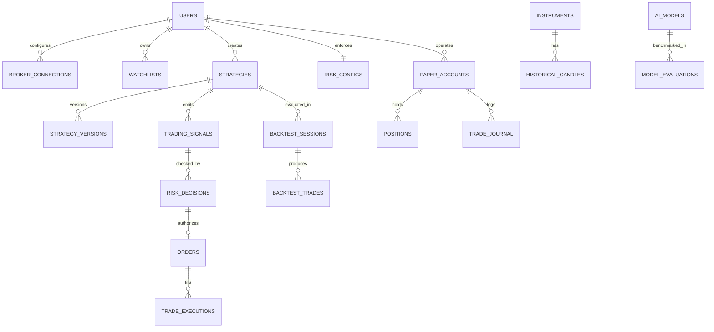

# Database Design (`DATABASE_DESIGN.md`)

## 1. Entity Relationship Diagram

## 2. Storage Tier Separation (AI Studio + Production Scaling)
- **Operational State (Persisted JSON Store / Firestore):** Users, watchlists, strategy configs/versions, risk configs, paper trading orders/positions/balances, risk audit logs, notifications, saved backtest summaries.
- **Time-Series Market Store (External PostgreSQL + TimescaleDB):** High-volume 1m/5m/15m OHLCV candles, corporate action adjustments, instrument masters, and computed feature snapshots. *Never push raw high-frequency tick streams into Firestore.*

## 3. Core Table Specifications & Constraints
- **Timestamps & Timezones:** All timestamps stored as UTC ISO-8601 (`TIMESTAMPTZ`), converted to `Asia/Kolkata` (`IST`, UTC+05:30) for session boundary logic (`09:15` open, `15:15` intraday square-off, `15:30` close).
- **Idempotency:** `orders.client_order_id` (`UUID`, `UNIQUE`) prevents duplicate dispatches on network retries.
- **Indexes:** Composite B-tree/Hypertable indexes on `(instrument_id, timeframe, timestamp DESC)` and `(account_id, created_at DESC)`.
