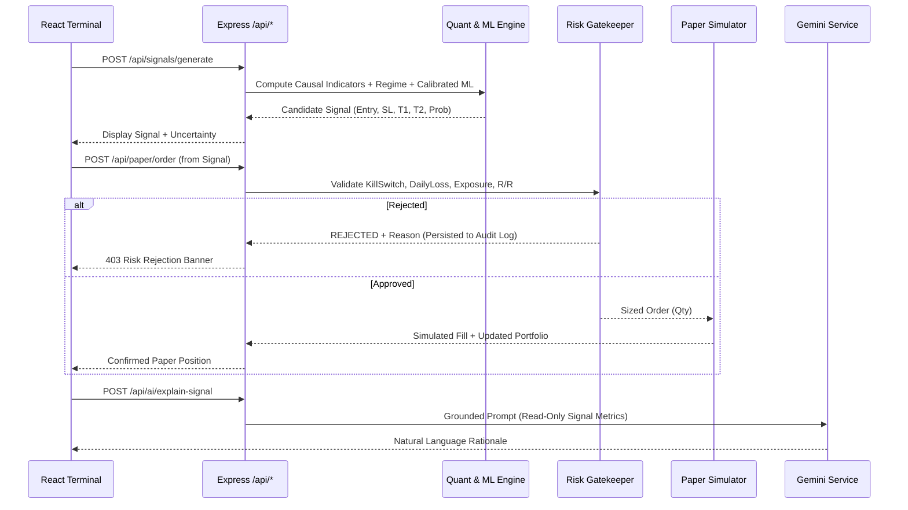
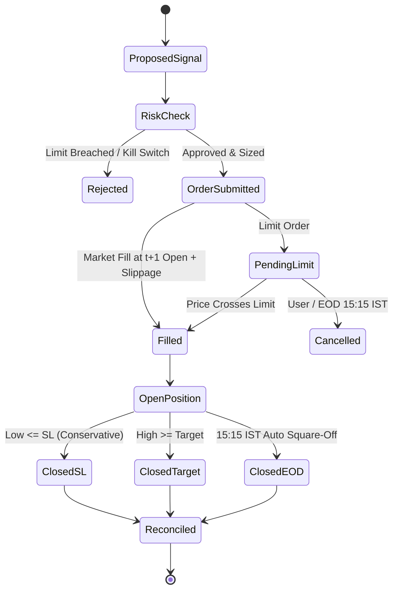
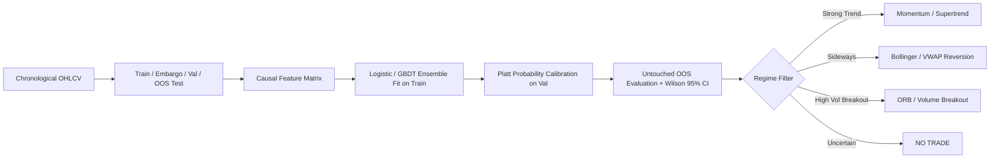

# System Design & Pipeline Specifications (`SYSTEM_DESIGN.md`)

## 1. Frontend / Backend & Data Ingestion Pipelines

## 2. Historical, Real-Time, AI Inference, Backtesting & Order Lifecycle

## 3. Model Training & Strategy Selection Workflow

